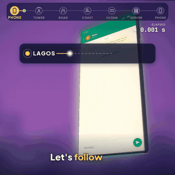
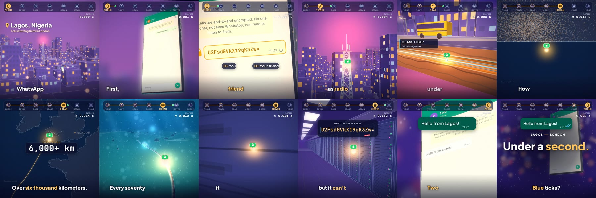
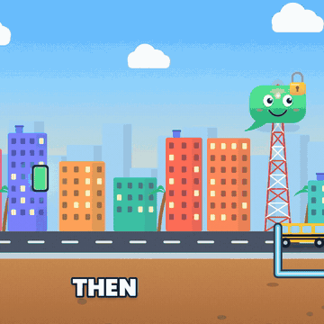
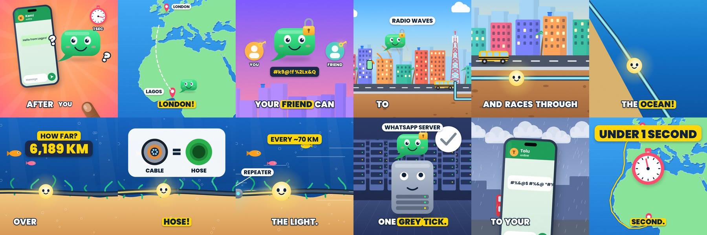

# What happens when you hit send on WhatsApp



A 51 second 3D explainer that follows one WhatsApp message from Lagos to London. The phone encrypts it, a tower sends it out as radio waves, it turns into light in fiber under the road, dives into the Atlantic, reaches a WhatsApp server and lands on the other phone in under a second.

Every frame, caption and sound in the video is made with code. There is no After Effects project and no editing timeline.



## How it works

The 3D scenes are built and rendered in Blender through Python. Each `3d/sec*_blend.py` builds one part of the journey (the Lagos skyline and phone, the street and fiber, the coast, the ocean floor, the server hall, London) and renders data passes. The matching `sec*_comp.py` turns those passes into a styled plate.

`3d/v3/render.py` is the final edit. It places the plates on the narration timeline with speed ramps, 2D camera moves and motion transitions like zoom throughs and whips, then draws the motion graphics layer on top.

The motion graphics are drawn with skia in `3d/v3/mg.py` and `3d/v3/overlay.py`: word by word captions with highlighted key words, callouts, a journey tracker with a live timer, the distance counter, tick bubbles and the end title.

`3d/v3/ui.py` draws the phone screens. On "scrambles it into code", the message text morphs into cipher text one letter at a time, right inside the chat bubble.

Everything is locked to the voice. `tools/asr/asrw.py` runs offline speech recognition on the narration to get a time for every word, `3d/v3/vo/map_asr.py` matches those words to the script, and `3d/v3/sjtl.py` warps the whole edit so each visual lands on the word it belongs to.

For sound, `3d/v3/bed.py` writes a quiet documentary music bed as MIDI and plays it through FluidSynth, and `3d/v3/mix3d.py` adds place ambience and synthesized sound effects and ducks the bed under the voice.

## Cartoon version



`cartoon-version/` tells the same story as a flat, bright cartoon with a smiling message bubble as the main character. Every scene is drawn with skia (`toon.py`, `props.py`, `anim.py`), with its own score (`music.py`) and mix (`mix.py`).



## Running it

You need Python 3.11, ffmpeg (with rubberband), FluidSynth and the FluidR3_GM soundfont.

```
pip install -r requirements.txt
```

1. Render the 3D passes, for example `python3 3d/sec1_blend.py -- 3d/r3d/s1 1 121`, for each section.
2. Render the final frames with `python3 3d/v3/render.py 0 1546`.
3. Build the sound with `python3 3d/v3/bed.py` and then `python3 3d/v3/mix3d.py`.
4. Encode:

```
ffmpeg -framerate 30 -i 3d/v3/frames/%04d.png -i 3d/v3/mix3d.wav -c:v libx264 -crf 20 -pix_fmt yuv420p -c:a aac -b:a 192k -shortest whatsapp_3d.mp4
```

Scripts find their files from the repo root. Set `PROJECT_ROOT` if you move things around.

Not in the repo because they are large or generated: rendered frames and passes, audio files, final videos, the narration recording, the Kokoro voice model (goes in `tools/tts/models/`) and the sherpa onnx English model (goes in `tools/asr/`).

## Built with
Python, Blender (bpy), skia, Pillow, NumPy, SciPy, FluidSynth, ffmpeg, and Claude (Anthropic) as coding partner.

Fonts in the `fonts` folders come from Google Fonts under the SIL Open Font License. Map data is from Natural Earth.
